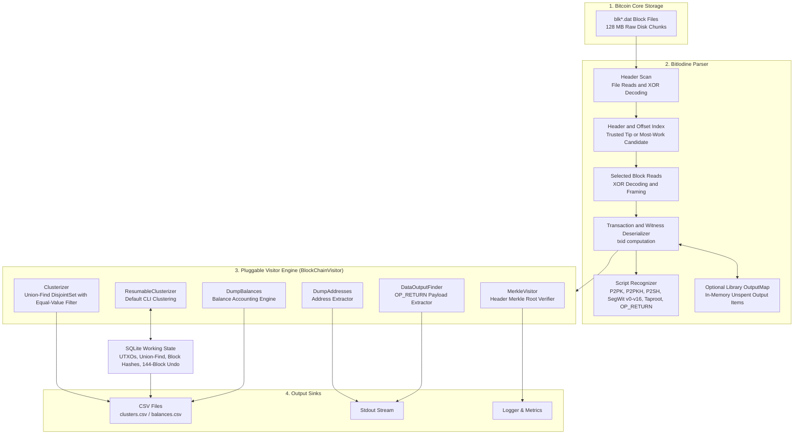
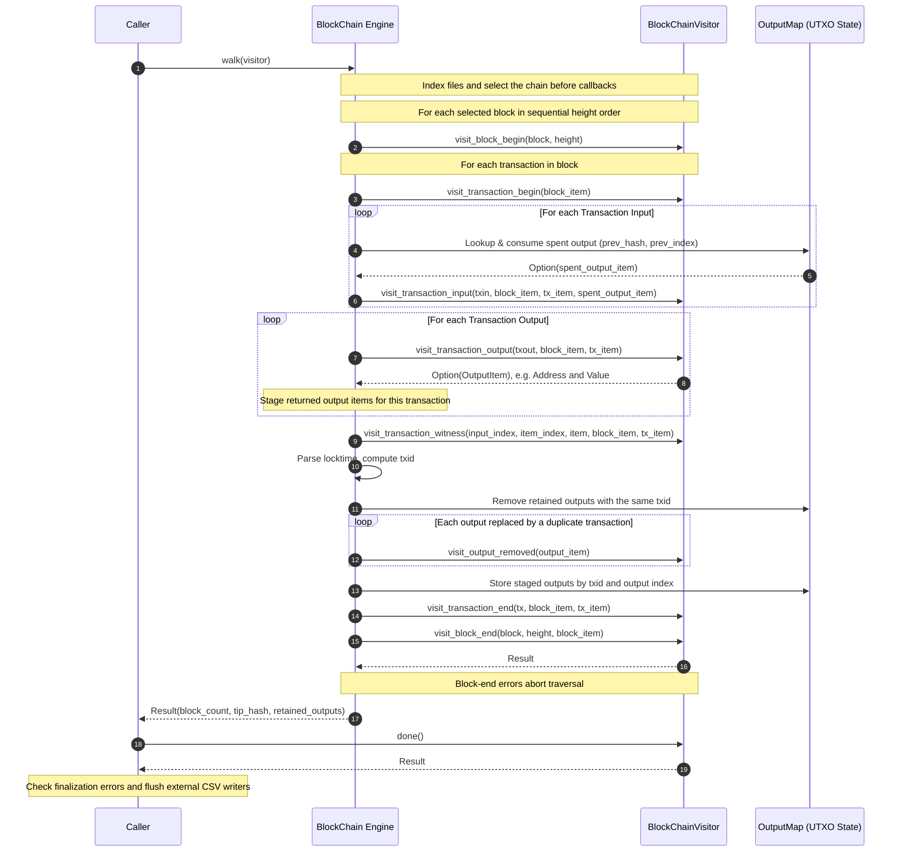
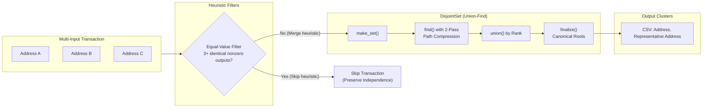

# BitIodine

[](https://github.com/mikispag/bitiodine/actions/workflows/ci.yml)
[](LICENSE)
[](https://www.rust-lang.org)

A Bitcoin blockchain parser and address clusterizer written in Rust.

BitIodine indexes raw `blk*.dat` files produced by `bitcoind`, selects a connected chain, then parses it in height order. Supply `--chain-tip` with a block hash accepted by Bitcoin Core to anchor the analysis to that chain; otherwise it selects the candidate with the most cumulative work among the supplied blocks. Its extensible **Visitor pattern** supports address balances, `OP_RETURN` extraction, and co-spend clustering using Union-Find.

CLI clustering stores UTXOs and Union-Find state in SQLite, commits each completed block, and resumes automatically on subsequent runs. Recent chain reorganizations are rolled back; reorganizations beyond retained undo history trigger a fresh replay from genesis.

---

## Features & Modern `bitcoind` Compatibility

BitIodine supports legacy and SegWit transaction serialization, including Bitcoin Core's `xor.dat` block-file obfuscation. It analyzes trusted Bitcoin Core mainnet data; it does not validate proof of work, scripts, difficulty transitions, or the full consensus rules. Block files can retain invalid candidates, so cumulative-work selection alone does not establish Core's active chain. Supply a trusted `--chain-tip` (for example, a captured `bitcoin-cli getbestblockhash` result) and analyze a consistent snapshot containing that block and its complete ancestry. Without an explicit tip, selection reflects only the supplied blocks, and equal-work best tips cause traversal to fail.

### Supported Script & Address Formats

| Script Type | Standard | Address Prefix | Status |
| :--- | :--- | :--- | :--- |
| **Pay-to-Pubkey (P2PK)** | Legacy (Genesis) | `1...` public-key identifier | ✅ Supported, including valid legacy hybrid keys |
| **Pay-to-PubkeyHash (P2PKH)** | Legacy | `1...` (Base58) | ✅ Supported |
| **Pay-to-ScriptHash (P2SH)** | BIP-16 | `3...` (Base58) | ✅ Supported |
| **P2SH-wrapped SegWit (P2SH-P2WPKH / P2SH-P2WSH)** | BIP-141 / BIP-143 | `3...` (Base58) | ✅ Supported |
| **Native SegWit v0 (P2WPKH)** | BIP-141 / BIP-173 | `bc1q...` (Bech32) | ✅ Supported |
| **Native SegWit v0 (P2WSH)** | BIP-141 / BIP-173 | `bc1q...` (Bech32) | ✅ Supported |
| **Taproot / SegWit v1 (P2TR)** | BIP-341 / BIP-350 | `bc1p...` (Bech32m) | ✅ Supported |
| **Future SegWit Witness Programs (v2–v16)** | BIP-141 / BIP-350 | `bc1...` (Bech32m) | ✅ Supported |
| **Bare Multisig (`OP_CHECKMULTISIG`)** | Legacy / BIP-11 | M-of-N public keys | ✅ Supported |
| **Null Data (`OP_RETURN`)** | Legacy / null data | Empty, single, or multiple pushed payloads | ✅ Supported, including PUSHDATA1/2/4 and numeric markers |
| **Timelock and other nonstandard scripts** | BIP-65 / BIP-112, others | No inferred standard destination | Heuristic classification only |

### Core Parser Capabilities

- ⚡ **Indexed Chain Traversal**: Indexes block headers and disk offsets before visiting the requested tip's ancestry or the most-work candidate. File reads use owned decoding buffers; transaction and script views borrow those buffers. CLI clustering bounds the in-memory index and keeps growing UTXO and cluster state on disk.
- 💾 **Resumable Clustering**: SQLite transactions preserve completed blocks across restarts, with 144 blocks of undo history for automatic reorg recovery. Page caching and disk spill avoid keeping the full clustering state in RAM.
- 👥 **Heuristic Address Clustering**: Multi-input clustering with rank-based Union-Find (`DisjointSet`), iterative path compression, and a filter for transactions with three or more identical nonzero output values. This filter does not reliably identify collaborative transactions: Payjoin and other patterns can cause false merges, and ordinary equal-value batches can be skipped. Cluster membership is evidence of possible common ownership, not proof.
- 🧩 **Pluggable Visitor Architecture**: Clean `BlockChainVisitor` trait to write custom analyzers, heuristics, and indexers.
- 🛡️ **Established Hashing and Work Arithmetic**: Uses `sha2` and `ripemd` for hashes and `bitcoin` for target/work arithmetic.
- 🖥️ **CLI with Dynamic Action Selection**: Run any visitor directly from the command line without recompiling.

---

## Node Requirements & Prerequisites

Use a stopped-node copy or a filesystem snapshot of the Bitcoin Core blocks directory. The header index and subsequent traversal must see consistent file contents. Ordinary file reads avoid mmap safety requirements; they do not make a changing dataset an atomic snapshot.

1. **Unpruned Node Required**:
   - The source node must retain the complete history (`prune=0`).
   - Pruned nodes delete early `blk*.dat` files (`blk00000.dat` onwards), preventing full historical analysis from Genesis.
2. **Default Block Paths**:
   - **Linux**: `~/.bitcoin/blocks/`
   - **macOS**: `~/Library/Application Support/Bitcoin/blocks/`
   - **Windows**: `%APPDATA%\Bitcoin\blocks\`

For a custom location such as `/var/lib/bitcoind/blocks/`, pass `--blocks-dir` explicitly. Keep `xor.dat` alongside the block files if the source directory contains it. Selected files must be regular files with consecutive numbers starting at `blk00000.dat`; discovery reports missing files and invalid XOR keys as errors.

### Memory and Disk Requirements

At startup, CLI clustering sets its allocation budget to the smaller of **32 GiB** and **80% of detected available RAM**. On Linux, available memory also accounts for cgroup headroom. Half of the budget goes to SQLite, whose LRU page-cache target uses 75% of that half; 128 MiB is reserved for other work, and the remainder bounds file discovery, the header index, chain selection, and block decoding. SQLite enforces a heap limit, disables memory mapping, and spills dirty pages and temporary work to disk. Startup fails when the resulting total budget is below 512 MiB; traversal fails before its conservative allocation estimate would exceed its assigned budget.

This makes disk-backed clustering suitable for machines with 32 GiB or less, provided the selected chain's header index fits its budget. The database, indexes, and recent undo records still need substantial disk space and grow with the dataset; an SSD is helpful. These are startup allocation limits, not a process-wide OS memory limit or protection against other processes consuming available RAM later. `dump-balances` and the original library `Clusterizer` retain growing state in memory; the CLI clustering policy does not bound those analyzers.

---

## Building

Requires Rust 1.85 or later. `Cargo.lock` is tracked, and CI tests both Rust 1.85 and current stable.

```bash
cargo build --locked --release
```

The optimized executable will be located at `target/release/bitiodine`.

The CLI enables jemalloc by default. To build with the system allocator, add `--no-default-features`.

---

## Usage

```bash
./target/release/bitiodine --help
```

| Option | Meaning | Default |
| :--- | :--- | :--- |
| `-b, --blocks-dir <BLOCKS_DIR>` | Source blocks directory | Platform-specific path above |
| `-o, --output <OUTPUT>` | CSV destination for `clusterizer` and `dump-balances` | `clusters.csv` |
| `-a, --action <ACTION>` | Visitor to run; choices listed below | `clusterizer` |
| `--max-blocks <MAX_BLOCKS>` | Maximum number of **block files**, not blocks or a height | `0` (all files) |
| `--chain-tip <CHAIN_TIP>` | End traversal at this independently accepted block hash | Most-work connected candidate |
| `--checkpoint-dir <CHECKPOINT_DIR>` | Persistent SQLite working directory; rejected for actions other than `clusterizer` | Output path with `.state` appended, e.g. `clusters.csv.state` |
| `-v`, `-vv` | Debug or trace logging | Info logging |
| `-h, --help` | Show help | |
| `-V, --version` | Show version | |

An explicit tip and every ancestor must be present in the selected files. Combining `--chain-tip` with a file limit that excludes that ancestry fails. The file limit alone does not identify a Core-accepted chain or a specific block height.

### Available Actions

| Action | Description | Output |
| :--- | :--- | :--- |
| `clusterizer` *(default)* | Resumes persistent co-spend clustering using a common-ownership heuristic | CSV (`<address>,<representative_address>`), no header |
| `dump-balances` | Calculates balances from surviving address-associated UTXOs | CSV (`<balance_btc>,<identifier_hash>,<address>`) |
| `dump-addresses` | Prints recognized output addresses and public-key identifiers; duplicates are retained | Stdout, one per line |
| `dump-tx-hashes` | Prints block summaries and transaction IDs at heights above 480,000 divisible by 1,000 | Stdout |
| `dataoutput-finder` | Streams `OP_RETURN` payloads or complete multi-push scripts | Stdout CSV (`<txid>,<vout>,<payload>`), no header |
| `donation-finder` | Streams positive-value donation or unknown-script candidates | Stdout CSV (`<txid>,<vout>,<satoshis>,<script_hex>`), no header |
| `merkle` | Verifies each selected block's transaction Merkle root against its header | Logs |

P2PK outputs and bare-multisig participants use P2PKH identifiers derived from their public keys when extracting addresses; those identifiers are not the original output scripts. Balances and clustering recognize exact standard single-destination scripts and P2PK; they do not assign one owner to bare multisig. The mainnet genesis coinbase is excluded from balances, and overwritten historical duplicate coinbases replace prior UTXO credits. A successful command exits zero only after traversal, visitor finalization, and output flushing succeed; failed runs may have streamed partial stdout or updated visitor state.

Cluster and balance CSV rows are unsorted. Cluster representatives are canonical address identifiers selected using the address type's ordering; only addresses participating in eligible merges appear in the cluster export. Balance rows have no header, omit zero balances, and format BTC values to eight decimal places. Their `identifier_hash` is the Base58 address's HASH160, or forty zero hex digits for witness addresses; use the full address column as the identifier.

CSV exports reject destinations that alias source block files or `xor.dat`, including symlinks and hardlinks. They are written to a temporary file beside the destination and published by rename only after writing and synchronization succeed, preserving previous results on write failure. Source aliases are rejected even when a file limit excludes the source file from traversal.

Finder output uses zero-based transaction output indexes. For bare `OP_RETURN` or a single push, the third field remains the payload in lowercase hexadecimal (empty for bare `OP_RETURN`). For multiple pushes it is `script:<complete_script_hex>`, including `OP_RETURN`; this preserves push boundaries, numeric markers, and opcode encodings. Malformed or non-push tails are not extracted. All logging goes to stderr, so stdout from the extraction actions can be redirected independently.

### Resuming and Recovering from Reorgs

The default clustering action creates `clusters.csv.state/` beside `clusters.csv`. Use `--checkpoint-dir` to keep the working database at a different location or to reuse it when changing the CSV destination. The directory contains `clusters.sqlite3`, SQLite journal files, and an exclusive `cluster.lock`; one process can use a state directory at a time.

Each block's UTXO changes, cluster merges, undo records, and height/hash are committed together after parsing and source checks succeed. An interrupted or failed block is rolled back, while earlier committed blocks remain available for the next run. CSV export happens after traversal and is published atomically, so an export failure preserves the previous CSV and does not discard completed database work.

On restart, BitIodine reindexes the selected files and compares the persisted block hashes with the selected chain. It resumes after the last committed block when ancestry still matches. Otherwise it restores the common ancestor using up to 144 blocks of retained undo records and processes the replacement branch. If the required undo records have expired, it clears derived state and automatically replays from genesis. Reopening at the already completed tip skips transaction replay and exports the saved result.

Recovery operates between runs against consistent source snapshots. It does not watch a live node, obtain a validated tip, or make changing block files safe to analyze. Continue to supply an independently accepted `--chain-tip` and all of its ancestors. Keep the working state outside the Bitcoin Core data directory; it contains derived data, never a replacement for the source blocks.

### Examples

**Capture an accepted tip while Bitcoin Core is available:**

```bash
BITIODINE_TIP="$(bitcoin-cli getbestblockhash)"
```

Stop the source node cleanly or obtain a consistent snapshot that contains that tip and its ancestors. Replace the placeholder below with the resulting blocks directory; preserve its `xor.dat` if present.

```bash
BITIODINE_BLOCKS=/path/to/blocks-snapshot
./target/release/bitiodine -b "$BITIODINE_BLOCKS" \
  --chain-tip "$BITIODINE_TIP" -o clusters.csv
```

Rerun the same command after an interruption, or with a newer consistent snapshot and accepted tip, to resume from `clusters.csv.state`. To choose a separate persistent directory:

```bash
./target/release/bitiodine -b "$BITIODINE_BLOCKS" \
  --chain-tip "$BITIODINE_TIP" --checkpoint-dir ./cluster-state -o clusters.csv
```

**Dump address balances on the same chain:**

```bash
./target/release/bitiodine -b "$BITIODINE_BLOCKS" \
  --chain-tip "$BITIODINE_TIP" -a dump-balances -o balances.csv -v
```

**Extract OP_RETURN data from that chain:**

```bash
./target/release/bitiodine -b "$BITIODINE_BLOCKS" \
  --chain-tip "$BITIODINE_TIP" -a dataoutput-finder > data-outputs.csv
```

**Explore the most-work candidate in the first 100 files:**

```bash
./target/release/bitiodine -b "$BITIODINE_BLOCKS" \
  --max-blocks 100 -a merkle
```

The last command checks transaction Merkle roots on a candidate chain; it does not establish that Core accepted that chain or validate witness commitments.

---

## Architecture

BitIodine is structured as a library (`bitiodine`) and a CLI application.

### High-Level System Architecture



### Visitor Event Lifecycle & Traversal Flow

The following diagram describes the general `walk` API. `walk_clusterizer_resumable` uses the same parser callbacks, but its visitor reads and spends UTXOs through SQLite and returns no in-memory output items. It begins a database transaction at block start; traversal commits only after block parsing and source checks succeed, and aborts the transaction on failure.



### Address Clustering Pipeline (In-Memory Library `Clusterizer`)

The persistent visitor applies the same transaction heuristic using database-backed Union-Find rows and canonical representatives. It does not build a second `DisjointSet` or UTXO map in Rust.



### Module Breakdown

- **`blockchain`**: Discovers `blk*.dat` files, decodes XOR records, indexes parent links and disk offsets, and selects the supplied tip's ancestry or the most-work connected candidate before updating visitor state. Resumable clustering checks persisted ancestry and recovers from reorganizations between runs. It does not consult Core's active-chain database or follow a live node.
- **`cluster_store`**: SQLite UTXOs, Union-Find rows, per-block transactions, retained undo history, bounded page caching, and streaming CSV export.
- **`block` & `header`**: Borrowed block and 80-byte header views over the traversal's owned decoding buffer (version, previous block hash, Merkle root, timestamp, bits, nonce).
- **`transactions` & `script`**: Transaction and witness deserialization, txid computation, exact standard-script recognition, and heuristic classification of other scripts. Noncanonical CompactSize encodings and superfluous witness serialization are rejected. Witness elements are available through visitor callbacks, and `Transaction::wtxid()` hashes the full serialization on demand. Witness commitment and full Script validation are not provided. Native witness recognition starts at mainnet height 481,824.
- **`hash` & `hash160`**: Type-safe wrappers for hashes. Block and transaction hash display reverses the internal digest bytes; Hash160 text preserves byte order.
- **`visitors`**: Implementation of analysis plugins conforming to `BlockChainVisitor`.

### Library API

`BlockChain::read(path, max_files)` is safe and returns `ParseResult<BlockChain>`. Use `with_tip(hash)` to anchor traversal. `walk(&mut visitor)` returns the selected block count (including genesis), selected tip hash, and retained visitor output items. It does not call `done()`; the caller must finalize the visitor and flush any external writers.

For persistent clustering, open a `cluster_store::ClusterStore`, borrow it with `visitors::ResumableClusterizer::with_store`, and call `walk_clusterizer_resumable`. This returns the full selected block count and tip; retained outputs stay in the database. `ClusterStore::write_csv` streams the result without constructing a global cluster map. The original `visitors::Clusterizer` and `walk` remain available for in-memory analysis.

Library callers choose their own budgets with `ClusterStore::open_with_memory_limit(directory, sqlite_bytes)` and `BlockChain::read_with_memory_limit(blocks_dir, max_files, traversal_bytes)`. The former sets a process-wide SQLite heap limit; an already lower SQLite limit takes precedence. The latter bounds discovery, indexing, chain selection, and decoding, excluding visitor-owned state and retained output maps. `with_memory_limit(bytes)` applies that traversal budget after discovery has already completed. The CLI's available-RAM detection and budget split are not automatically applied by these library APIs.

Constructor migration: the trait's `BlockChainVisitor::new()` now requires `Self: Default`. Generic code calling `V::new()` needs `V: BlockChainVisitor + Default`; custom visitors can implement `Default` or use an explicit constructor instead. Existing built-in visitor constructors are unchanged. The persistent visitor requires `ResumableClusterizer::with_store` so that it always has a valid store.

Visitor output items belong to the UTXO tracker until spent or replaced. `visit_output_removed` handles historical duplicate-txid replacements; `visit_block_end` returns `ParseResult<()>` and can stop traversal on a sink or validation error. On failure, discard partially updated visitor state before retrying.

`visit_transaction_witness` runs after output callbacks, once per witness element, including empty elements. Empty stacks and legacy transactions emit no witness callbacks. The CompactSize and transaction parsing APIs return `ParseResult`, distinguishing malformed data from truncated input. File traversal errors include the source path and byte offset when available.

Build the API reference and its usage example locally:

```bash
cargo doc --locked --no-deps
```

Open `target/doc/bitiodine/index.html`. The crate-level example is also available in [src/lib.rs](src/lib.rs), and the callback contract in [src/visitors/mod.rs](src/visitors/mod.rs).

---

## Testing

Run the checks used by CI, including the library documentation example:

```bash
cargo fmt --all -- --check
cargo clippy --locked --all-targets --all-features -- -D warnings
cargo test --locked --all-targets --all-features
cargo test --locked --all-targets --no-default-features
cargo test --locked --doc
```

CI runs both test configurations on Rust 1.85 and stable. The regression suite covers chain ordering and work selection, explicit tips, XOR framing, truncated transactions, script recognition, historical balances, and CLI/sink failures. Persistent-clustering tests compare CSV and complete UTXO state with uninterrupted in-memory analysis across extension, shallow and deep reorgs, failed blocks, and memory-budget failures.

An opt-in integration test compares sampled blocks, transactions, and Merkle roots against `rust-bitcoin`. It only reads existing files and never starts a node or invokes RPC:

```bash
BITIODINE_BLOCKS_DIR=/path/to/blocks-snapshot \
  cargo test --locked --release --test local_data_tests -- --ignored --nocapture
```

## Benchmarking

On Linux, run the benchmark harness against a consistent blocks directory:

```bash
./bench/bench.sh --blocks-dir "$BITIODINE_BLOCKS" 100
```

The final argument limits block files (default: 500). The harness measures both CSV actions and appends results to [bench/results.md](bench/results.md). It uses unanchored candidate selection. That page's existing measurements predate the correctness fixes, indexed traversal, and disk-backed clustering default; they are historical comparisons, not performance, RAM-use, or correctness guarantees for the current implementation. No performance measurements for the persistent implementation are reported here.

---

## Research & Academic Citation

BitIodine is based on the pioneering academic research on Bitcoin transaction graph analysis and address clustering:

> **[BitIodine: Extracting Intelligence from the Bitcoin Network](https://link.springer.com/chapter/10.1007/978-3-662-45472-5_29)**  
> Michele Spagnuolo, Federico Maggi, and Stefano Zanero  
> *Financial Cryptography and Data Security (FC 2014)*, Lecture Notes in Computer Science, vol 8437. Springer, Berlin, Heidelberg.  
> DOI: [10.1007/978-3-662-45472-5_29](https://doi.org/10.1007/978-3-662-45472-5_29)

If you use BitIodine in academic research, please cite the paper:

```bibtex
@inproceedings{spagnuolo2014bitiodine,
  title     = {{BitIodine}: Extracting Intelligence from the {Bitcoin} Network},
  author    = {Spagnuolo, Michele and Maggi, Federico and Zanero, Stefano},
  booktitle = {Financial Cryptography and Data Security (FC)},
  series    = {Lecture Notes in Computer Science},
  volume    = {8437},
  pages     = {457--468},
  year      = {2014},
  publisher = {Springer},
  doi       = {10.1007/978-3-662-45472-5_29}
}
```

---

## Credits

The blockchain parser architecture is based on research and code originally developed by Michele Spagnuolo ([miki.it](https://miki.it)) and Mathias Svensson.
