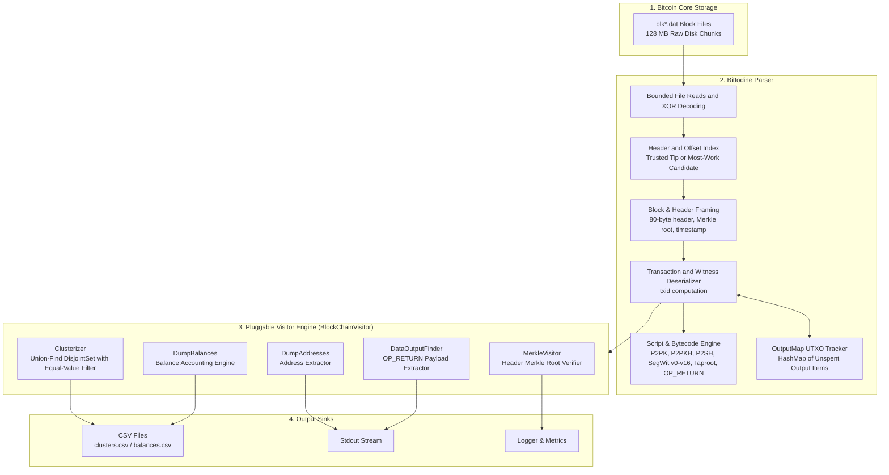
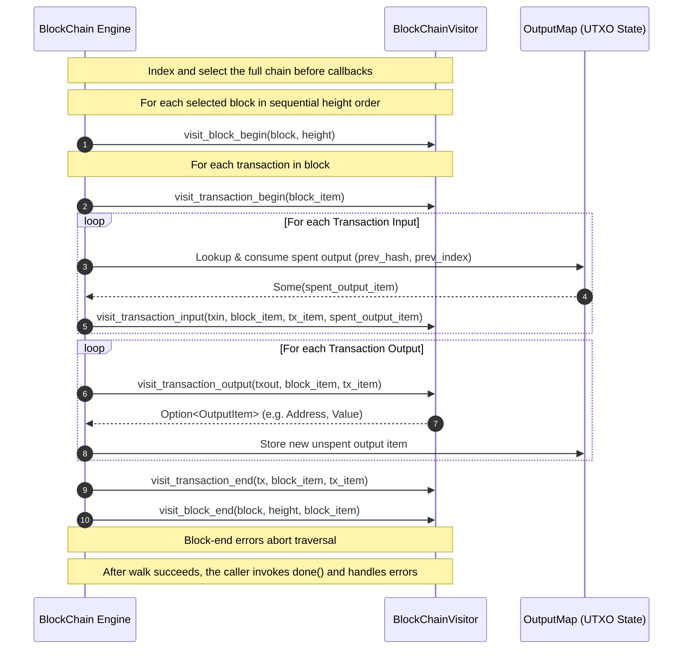
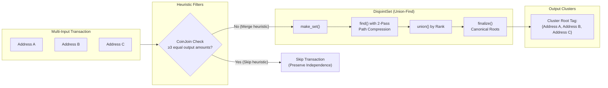

# BitIodine

[](https://github.com/mikispag/bitiodine/actions/workflows/ci.yml)
[](LICENSE)
[](https://www.rust-lang.org)

A Bitcoin blockchain parser and address clusterizer written in Rust.

BitIodine indexes raw `blk*.dat` files produced by `bitcoind`, selects a connected chain, then parses it in height order. Supply `--chain-tip` with a block hash accepted by Bitcoin Core to anchor the analysis to that chain; otherwise it selects the candidate with the most cumulative work among the supplied blocks. Its extensible **Visitor pattern** supports address balances, `OP_RETURN` extraction, and co-spend clustering using Union-Find.

---

## Features & Modern `bitcoind` Compatibility

BitIodine supports legacy and SegWit transaction serialization, including Bitcoin Core's `xor.dat` block-file obfuscation. It analyzes trusted Bitcoin Core mainnet data; it does not validate proof of work, scripts, difficulty transitions, or the full consensus rules. Block files can retain invalid candidates, so cumulative-work selection alone does not establish Core's active chain. Supply a trusted `--chain-tip` (for example, a captured `bitcoin-cli getbestblockhash` result) and analyze a consistent snapshot containing that block and its complete ancestry. Without an explicit tip, selection reflects only the supplied blocks, and equal-work best tips cause traversal to fail.

### Supported Script & Address Formats

| Script Type | Standard | Address Prefix | Status |
| :--- | :--- | :--- | :--- |
| **Pay-to-Pubkey (P2PK)** | Legacy (Genesis) | Raw compressed / uncompressed pubkey | ✅ Supported |
| **Pay-to-PubkeyHash (P2PKH)** | Legacy | `1...` (Base58) | ✅ Supported |
| **Pay-to-ScriptHash (P2SH)** | BIP-16 | `3...` (Base58) | ✅ Supported |
| **P2SH-wrapped SegWit (P2SH-P2WPKH / P2SH-P2WSH)** | BIP-141 / BIP-143 | `3...` (Base58) | ✅ Supported |
| **Native SegWit v0 (P2WPKH)** | BIP-141 / BIP-173 | `bc1q...` (Bech32) | ✅ Supported |
| **Native SegWit v0 (P2WSH)** | BIP-141 / BIP-173 | `bc1q...` (Bech32) | ✅ Supported |
| **Taproot / SegWit v1 (P2TR)** | BIP-341 / BIP-350 | `bc1p...` (Bech32m) | ✅ Supported |
| **Future SegWit Witness Programs (v2–v16)** | BIP-141 / BIP-350 | `bc1...` (Bech32m) | ✅ Supported |
| **Bare Multisig (`OP_CHECKMULTISIG`)** | Legacy / BIP-11 | M-of-N public keys | ✅ Supported |
| **Null Data (`OP_RETURN`)** | Core 0.9+ | Arbitrary payload data | ✅ Supported |
| **Timelock and other nonstandard scripts** | BIP-65 / BIP-112, others | No inferred standard destination | Heuristic classification only |

### Core Parser Capabilities

- ⚡ **Indexed Chain Traversal**: Indexes block headers and disk offsets before visiting the requested tip's ancestry or the most-work candidate. Block decoding buffers are bounded; the block index, UTXO state, and address/cluster maps grow with the dataset.
- 👥 **Heuristic Address Clustering**: Multi-input clustering with rank-based Union-Find (`DisjointSet`), iterative path compression, and a filter for transactions with three or more equal output values. This filter does not reliably identify collaborative transactions: Payjoin and other patterns can cause false merges, and ordinary equal-value batches can be skipped. Cluster membership is evidence of possible common ownership, not proof.
- 🧩 **Pluggable Visitor Architecture**: Clean `BlockChainVisitor` trait to write custom analyzers, heuristics, and indexers.
- 🛡️ **Established Hashing and Work Arithmetic**: Uses `sha2` and `ripemd` for hashes and `bitcoin` for target/work arithmetic.
- 🖥️ **CLI with Dynamic Action Selection**: Run any visitor directly from the command line without recompiling.

---

## Node Requirements & Prerequisites

Use a stopped-node copy or a filesystem snapshot of the Bitcoin Core blocks directory. The header index and subsequent traversal must see consistent file contents. Ordinary file reads avoid mmap safety requirements; they do not make a changing dataset an atomic snapshot.

1. **Unpruned Node Required**:
   - The source node must retain the complete history (`prune=0`).
   - Pruned nodes delete early `blk*.dat` files (`blk00000.dat` onwards), preventing full historical analysis from Genesis.
2. **Default Block Paths**:
   - **Linux**: `~/.bitcoin/blocks/` (or `/var/lib/bitcoind/blocks/`)
   - **macOS**: `~/Library/Application Support/Bitcoin/blocks/`
   - **Windows**: `%APPDATA%\Bitcoin\blocks\`

---

## Building

Requires Rust 1.85 or later. `Cargo.lock` is tracked, and CI tests both Rust 1.85 and current stable.

```bash
cargo build --locked --release
```

The optimized executable will be located at `target/release/bitiodine`.

---

## Usage

```text
A high-performance Bitcoin blockchain parser and address clusterizer in Rust.

Usage: bitiodine [OPTIONS]

Options:
  -b, --blocks-dir <BLOCKS_DIR>  Path to the bitcoind blocks directory [default: ~/.bitcoin/blocks]
  -o, --output <OUTPUT>          Path to the output file [default: clusters.csv]
  -a, --action <ACTION>          Action / visitor to run [default: clusterizer]
                                 [possible values: clusterizer, dump-balances, dump-addresses,
                                  dump-tx-hashes, dataoutput-finder, donation-finder, merkle]
      --max-blocks <MAX_BLOCKS>  Limit block files read (0 = no limit) [default: 0]
      --chain-tip <CHAIN_TIP>    Select the chain ending at this block hash
  -v...                          Sets the level of verbosity (-v for debug, -vv for trace)
  -h, --help                     Print help
  -V, --version                  Print version
```

### Available Actions

| Action | Description | Output |
| :--- | :--- | :--- |
| `clusterizer` *(default)* | Groups co-spent addresses using a common-ownership heuristic | CSV (`<address>,<cluster_id>`) |
| `dump-balances` | Calculates balances from surviving address-associated UTXOs | CSV (`<balance_btc>,<identifier_hash>,<address>`) |
| `dump-addresses` | Prints recognized output addresses and public-key identifiers; duplicates are retained | Stdout, one per line |
| `dump-tx-hashes` | Logs transaction IDs at regular block intervals | Stdout |
| `dataoutput-finder` | Streams `OP_RETURN` payloads as lossless hexadecimal | Stdout CSV (`<txid>,<vout>,<payload_hex>`), no header |
| `donation-finder` | Streams positive-value donation or unknown-script candidates | Stdout CSV (`<txid>,<vout>,<satoshis>,<script_hex>`), no header |
| `merkle` | Verifies each selected block's transaction Merkle root against its header | Logs |

P2PK outputs and bare-multisig participants use P2PKH identifiers derived from their public keys when extracting addresses; those identifiers are not the original output scripts. Balances and clustering recognize exact standard single-destination scripts and P2PK; they do not assign one owner to bare multisig. The mainnet genesis coinbase is excluded from balances, and overwritten historical duplicate coinbases replace prior UTXO credits. A successful command exits zero only after traversal, visitor finalization, and output flushing succeed; failed runs may have streamed partial stdout or updated visitor state.

### Examples

**Run address clusterizer against default bitcoin directory:**
```bash
./target/release/bitiodine -o clusters.csv
```

**Dump address balances from a custom blocks path with debug logging:**
```bash
./target/release/bitiodine -b /var/lib/bitcoind/blocks -a dump-balances -o balances.csv -v
```

**Find OP_RETURN data payloads:**
```bash
./target/release/bitiodine -b /var/lib/bitcoind/blocks -a dataoutput-finder
```

---

## Architecture

BitIodine is structured as a library (`bitiodine`) and a CLI application.

### High-Level System Architecture



### Visitor Event Lifecycle & Traversal Flow



### Address Clustering Pipeline (`Clusterizer`)



### Module Breakdown

- **`blockchain`**: Discovers `blk*.dat` files, decodes XOR records, indexes parent links and disk offsets, and selects the supplied tip's ancestry or the most-work connected candidate before updating visitor state. It does not consult Core's active-chain database or support live reorg rollback.
- **`block` & `header`**: Zero-copy block framing and 80-byte header deserialization (version, previous block hash, Merkle root, timestamp, bits, nonce).
- **`transactions` & `script`**: High-level Bitcoin transaction, input, output, and script bytecode interpreter (P2PK, P2PKH, P2SH, SegWit P2WPKH/P2WSH, Taproot P2TR, Multisig, `OP_RETURN`).
- **`hash` & `hash160`**: Type-safe wrappers for hashes. Block and transaction hash display reverses the internal digest bytes; Hash160 text preserves byte order.
- **`visitors`**: Implementation of analysis plugins conforming to `BlockChainVisitor`.

---

## Testing

Run the test suite:

```bash
cargo test --locked
```

Run clippy linter:

```bash
cargo clippy --locked --all-targets -- -D warnings
```

---

## Research & Academic Citation

BitIodine is based on the pioneering academic research on Bitcoin transaction graph analysis and address clustering:

> **[BitIodine: Extracting Intelligence from the Bitcoin Network](https://link.springer.com/chapter/10.1007/978-3-662-45472-5_29)**  
> Michele Spagnuolo, Federico Maggi, and Stefano Zanero  
> *Financial Cryptography and Data Security (FC 2014)*, Lecture Notes in Computer Science, vol 8437. Springer, Berlin, Heidelberg.  
> DOI: [10.1007/978-3-662-45472-5_29](https://doi.org/10.1007/978-3-662-45472-5_29)

If you use BitIodine in academic research, please cite the paper:

```bibtex
@inproceedings{spagnuolo2014bitiodine,
  title     = {{BitIodine}: Extracting Intelligence from the {Bitcoin} Network},
  author    = {Spagnuolo, Michele and Maggi, Federico and Zanero, Stefano},
  booktitle = {Financial Cryptography and Data Security (FC)},
  series    = {Lecture Notes in Computer Science},
  volume    = {8437},
  pages     = {457--468},
  year      = {2014},
  publisher = {Springer},
  doi       = {10.1007/978-3-662-45472-5_29}
}
```

---

## Credits

The blockchain parser architecture is based on research and code originally developed by Michele Spagnuolo ([miki.it](https://miki.it)) and Mathias Svensson.
